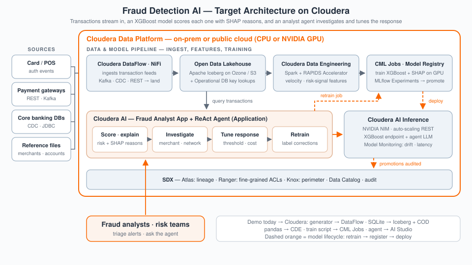

# Cloudera Blueprint: TCO for Fraud Detection Models

> End-to-end **fraud analytics** on Cloudera: synthetic transactions, **XGBoost** scoring with **SHAP** explainability, a React risk dashboard, and a **ReAct** agent over **Cloudera AI Inference** — deployable as a single **CML AMP**, with optional **RAPIDS** GPU acceleration and a target lakehouse architecture for production TCO conversations.

## Table of Contents

- [Overview](#overview)
- [Demo](#demo)
- [Use Case](#use-case)
- [Key Features](#key-features)
- [Quickstart / Guide](#quickstart--guide)
- [Architecture / Software Components](#architecture--software-components)
- [Target Audience](#target-audience)
- [Repository Structure](#repository-structure)
- [Prerequisites](#prerequisites)
- [Hardware Requirements](#hardware-requirements)
- [Documentation](#documentation)
- [License](#license)

## Overview

Fraud Detection AI is a full-stack fraud-analytics blueprint that runs as a single Cloudera Machine Learning (CML) Applied ML Prototype (AMP). Synthetic transaction data (200K transactions across 31 countries with realistic fraud patterns) is generated, preprocessed, and used to train an XGBoost fraud-scoring model with SHAP explainability. A FastAPI backend serves predictions and a React 19 dashboard visualizes risk, transactions, and SHAP-driven explanations. A ReAct-style AI agent, backed by a pluggable LLM provider (Cloudera AI Inference, vLLM, or Ollama), answers natural-language questions about fraud activity over the live data. GPU acceleration via NVIDIA RAPIDS is optional and auto-detected.

## Demo

Reprise demo: [https://app.getreprise.com/present/mnJeVB6](https://app.getreprise.com/present/mnJeVB6)

Workshop material ships in the repo: `[workshop/](workshop/)` has a facilitator guide, a four-module presentation track, and an instructor-led lab.

## Use Case

Fraud teams need a fast, explainable way to separate legitimate transactions from fraudulent ones, and to interrogate why a model flagged a given transaction — not just a score. This blueprint demonstrates an end-to-end pattern: synthetic data generation → feature engineering → gradient-boosted model training → SHAP explainability → a natural-language agent interface, all deployable as a single CML AMP with no external data dependencies.

## Key Features

- One-click AMP deployment: a single `deploy/install.py` task provisions Python deps, GPU/RAPIDS auto-detection, Node.js, and the production React build.
- Synthetic data generator producing 200K transactions with realistic cross-border, high-velocity, and unusual-amount fraud patterns — no real financial data required.
- XGBoost fraud-scoring model with SHAP `pred_contribs` explainability served in-process alongside the API.
- React 19 + TypeScript + Tailwind dashboard: risk overview, transaction table, SHAP charts, threshold analysis, fraud-network panel, and an experiment lab.
- ReAct-style AI agent for natural-language fraud analysis, with a pluggable LLM provider (Cloudera AI Inference Service, vLLM, or Ollama) and live token-cost counter.
- Optional NVIDIA RAPIDS GPU acceleration, auto-detected and gracefully falling back to CPU (`FRAUD_DETECTION_FORCE_CPU=1` to force CPU mode).

## Quickstart / Guide

1. Clone the repository.
2. Deploy as an AMP in Cloudera Machine Learning: create a new project from this repo. `.project-metadata.yaml` runs the task chain `deploy/install.py` → data generation → preprocessing → feature engineering → model training → the dashboard Application.
3. Configure an LLM provider for the agent (Cloudera AI Inference, vLLM, or Ollama) via `config/config.yaml` / a local `.env` — see `[deploy/README.md](deploy/README.md)`.
4. Local/Docker alternative: `docker compose up -d --build` runs the same app outside CML (the LLM endpoint stays remote).
5. Full build/run detail — feature tour, pipeline walkthrough, GPU setup, API reference — is in `[docs/APP_GUIDE.md](docs/APP_GUIDE.md)`.

## Architecture / Software Components

**Target architecture on Cloudera.** Transactions stream in, an XGBoost model scores each one with SHAP reasons, and an analyst agent investigates and tunes the response.

- **Cloudera DataFlow (NiFi)** — ingests card / POS authorizations, payment-gateway and core-banking feeds over Kafka, CDC and REST.
- **Apache Iceberg on Ozone / S3** — holds transaction history; **Cloudera Operational Database** serves fast key lookups during real-time scoring.
- **Cloudera Data Engineering** — Spark with the RAPIDS Accelerator builds the velocity and risk-signal features.
- **Cloudera AI Jobs, Experiments (MLflow) and Model Registry** — train XGBoost + SHAP (GPU optional), track runs, and promote model versions.
- **Cloudera AI Inference** — hosts the XGBoost scoring endpoint and the agent's LLM; Model Monitoring watches drift and latency.
- **Cloudera AI Application** — the analyst dashboard and ReAct agent: score and explain, investigate merchants and fraud networks, tune thresholds against cost, and trigger retraining from label corrections.
- **SDX** — Atlas lineage, Ranger fine-grained access, Knox perimeter security, Data Catalog, and an audit trail of model promotions.

**How the demo runs today.** The pipeline runs as a chain of CML AMP tasks: synthetic transaction generation → preprocessing → feature engineering → XGBoost model training (with SHAP explainability) → a long-running dashboard Application. The `app/` layer is a single CML Application combining a FastAPI backend (`app/backend/`, serving transactions, dashboard, SHAP, thresholds, experiments, and agent chat via SSE) with a React frontend (`app/frontend/`) built at install time. The AI agent calls out to a pluggable LLM provider on Cloudera AI Inference Service (or vLLM/Ollama) using a ReAct tool-calling pattern over the same model-serving and data layers the dashboard uses. See `[docs/architecture/cloudera_deployment_blueprint.md](docs/architecture/cloudera_deployment_blueprint.md)` for the full Cloudera service mapping and Dev/Test/Prod deployment topology, with companion diagrams in `[docs/architecture/](docs/architecture/)`.

## Target Audience

- Solution architects evaluating an end-to-end fraud-analytics reference on Cloudera Machine Learning
- Data scientists interested in a tested XGBoost + SHAP explainability pattern
- AI engineers building ReAct-style natural-language agents over a live model-serving API
- Sales engineers and field teams running a financial-services fraud-detection demo

## Repository Structure

| Path                                | Description                                                                                                               |
| ----------------------------------- | ------------------------------------------------------------------------------------------------------------------------- |
| `assets/`                           | Diagrams, screenshots, sample media                                                                                       |
| `deploy/`                           | CML AMP provisioning (`install.py`) — the environment-setup task the AMP runs first                                       |
| `docs/`                             | Extended documentation: app guide, architecture blueprint + diagrams                                                      |
| `METADATA.yaml`                     | Catalog metadata for the Cloudera blueprint website                                                                       |
| `app/`                              | The user-facing application: FastAPI backend (`backend/`) + React frontend (`frontend/`), run as a single CML Application |
| `pipelines/`                        | Data generation, preprocessing, feature engineering, and model training scripts (the AMP task chain)                      |
| `models/`                           | Trained model artifacts and experiment metrics                                                                            |
| `data/`                             | Generated synthetic transaction data (gitignored at runtime)                                                              |
| `config/`                           | Runtime configuration (`config.yaml`), LLM provider settings                                                              |
| `governance/`                       | Model documentation                                                                                                       |
| `tests/`                            | Test conventions for this accelerator                                                                                     |
| `workshop/`                         | Facilitator guide, presentation modules, and instructor lab for a hands-on workshop                                       |
| `.project-metadata.yaml`            | CML AMP manifest — the task chain and the dashboard Application                                                           |
| `Dockerfile` / `docker-compose.yml` | The local/on-prem container path (same app, remote LLM endpoint)                                                          |

## Prerequisites

- A Cloudera Machine Learning (CML) workspace to host the AMP, or Docker for the local/on-prem path
- An LLM endpoint for the agent: Cloudera AI Inference Service, a vLLM endpoint, or a local Ollama instance
- For local validation: Python 3.11, Node.js (installed automatically by `deploy/install.py` if absent)

## Hardware Requirements

| Deployment              | Minimum                                                                                                                                                    |
| ----------------------- | ---------------------------------------------------------------------------------------------------------------------------------------------------------- |
| Launchable / demo       | AMP task sessions run at 2 vCPU / 4–8 GB RAM / optional 1 GPU (per `.project-metadata.yaml`); GPU is auto-detected and optional everywhere (NVIDIA RAPIDS) |
| Production / enterprise | TODO — not sized beyond the AMP task profile; scales with transaction volume and training cadence                                                          |

## Documentation

- `[docs/APP_GUIDE.md](docs/APP_GUIDE.md)` — the authoritative build/run guide
- `[deploy/README.md](deploy/README.md)` — provisioning, environment variables, Docker path
- `[docs/architecture/](docs/architecture/)` — the Cloudera deployment blueprint and diagrams
- `[app/README.md](app/README.md)` — the application layer (backend + frontend)
- `[pipelines/README.md](pipelines/README.md)` — the AMP task chain, in order
- `[workshop/](workshop/)` — facilitator guide and four-module presentation track

## License

This project is licensed under the [Apache License 2.0](LICENSE).