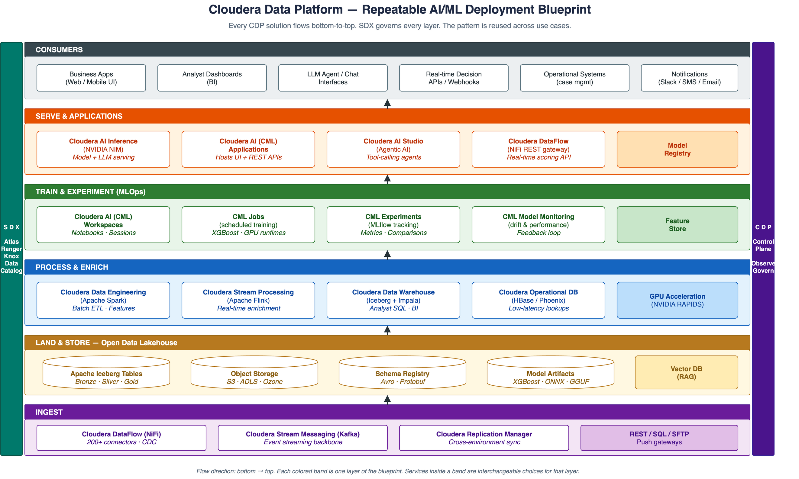
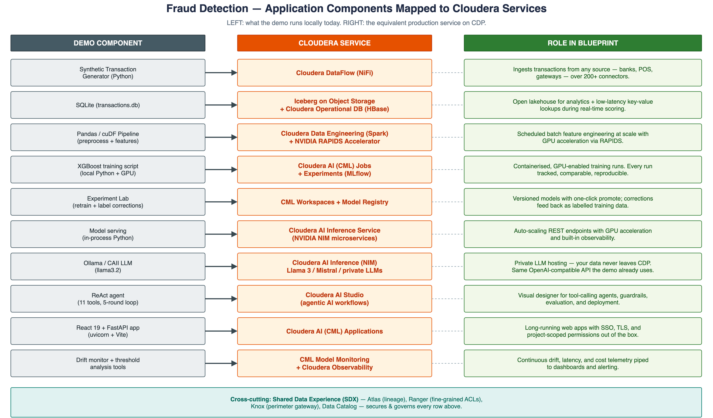
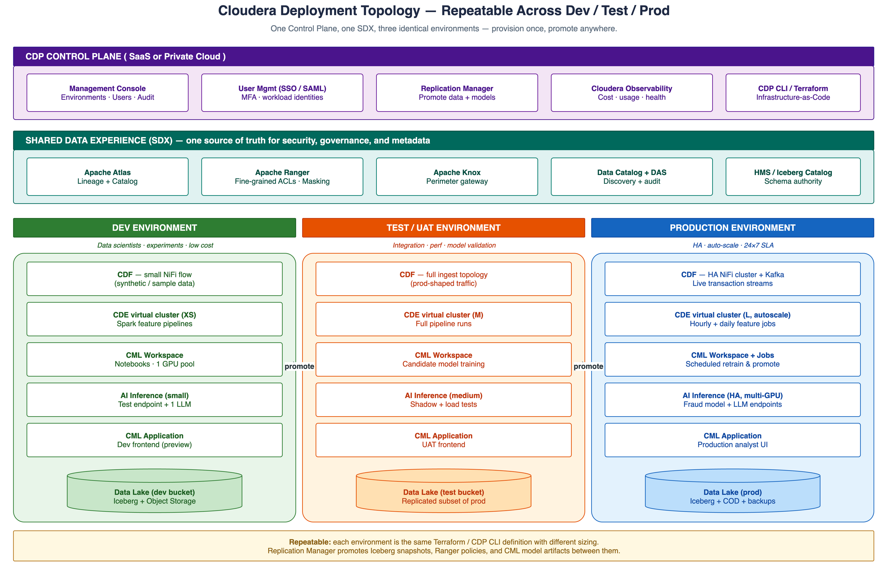

# Fraud Detection on Cloudera — Deployment Blueprint

> A repeatable, pattern-based deployment of the fraud detection demo on the **Cloudera Data Platform (CDP)**.
> The point of this document is the *blueprint* — the same pattern is reused across business domains
> (fraud, churn, AML, claims, recommendations…). Specific code is intentionally not the focus.

---

## How to view the diagrams

Three companion `.drawio` files live alongside this document:

| Diagram | File |
|---|---|
| 1. CDP Repeatable Pattern (layered) | [`cloudera_blueprint_pattern.drawio`](./cloudera_blueprint_pattern.drawio) |
| 2. Fraud-Detection → Cloudera Service Mapping | [`cloudera_fraud_mapping.drawio`](./cloudera_fraud_mapping.drawio) |
| 3. Deployment Topology (Dev / Test / Prod) | [`cloudera_deployment_topology.drawio`](./cloudera_deployment_topology.drawio) |

Open them in **draw.io Desktop**, the **VS Code "Draw.io Integration"** extension, or
[app.diagrams.net](https://app.diagrams.net). The PNGs in `./images/` are
exported from them; after editing a diagram, re-export it (`File → Export As → PNG`) so the images below stay current.

```
docs/
├── cloudera_deployment_blueprint.md    ← you are here
├── cloudera_blueprint_pattern.drawio
├── cloudera_fraud_mapping.drawio
├── cloudera_deployment_topology.drawio
└── images/                             ← exported PNGs land here
    ├── cloudera_blueprint_pattern.png
    ├── cloudera_fraud_mapping.png
    └── cloudera_deployment_topology.png
```

---

## 1. The repeatable pattern

Every CDP solution — fraud detection, customer 360, AML, predictive maintenance —
follows the same six-layer flow. Build it once, reuse for every use case.


*Source: [`cloudera_blueprint_pattern.drawio`](./cloudera_blueprint_pattern.drawio)*

| Layer | Cloudera Services | Purpose |
|---|---|---|
| **Ingest** | Cloudera DataFlow (NiFi), Stream Messaging (Kafka), Replication Manager | Pull data from any source, any cadence |
| **Land & Store** | Apache Iceberg on object storage (S3 / ADLS / Ozone), Schema Registry | Open lakehouse — single source of truth |
| **Process & Enrich** | Cloudera Data Engineering (Spark), Stream Processing (Flink), Data Warehouse (Impala), Operational DB (HBase) | Batch & streaming feature pipelines, analytics, low-latency lookups |
| **Train & Experiment** | Cloudera AI (CML) Workspaces · Jobs · Experiments · Model Registry · Model Monitoring · Feature Store | End-to-end MLOps with GPU acceleration |
| **Serve & Apps** | Cloudera AI Inference (NVIDIA NIM), CML Applications, AI Studio | Model + LLM serving, hosted apps, agentic workflows |
| **Consume** | Web/mobile UIs, BI dashboards, real-time APIs, downstream operational systems | Where the value lands |

Cross-cutting layer: **Shared Data Experience (SDX)** — Atlas (lineage), Ranger (fine-grained ACLs),
Knox (perimeter), Data Catalog — secures and governs every layer above.
The **CDP Control Plane** owns environments, identities, replication, and observability.

> **Why this matters:** the blueprint is the contract. Once your team knows it, a new use case is
> "swap the model, swap the data sources, reuse the layers" — not a green-field architecture exercise.

---

## 2. Mapping the fraud-detection demo to Cloudera

The current demo runs entirely on a single laptop / workstation. The diagram below shows what each
component becomes when deployed on CDP. Nothing about the *application* changes — the demo's REST
contracts, model format, agent-tool schemas all stay the same. What changes is what's underneath them.


*Source: [`cloudera_fraud_mapping.drawio`](./cloudera_fraud_mapping.drawio)*

### Component-by-component

| Demo today | Cloudera service in production | What you gain |
|---|---|---|
| Synthetic data generator | **Cloudera DataFlow (NiFi)** | 200+ connectors to real source systems (Kafka, JDBC, files, REST, CDC) |
| SQLite `transactions.db` | **Iceberg tables** + **Cloudera Operational Database** | ACID lakehouse + sub-millisecond key lookups |
| Pandas / cuDF pipeline | **Cloudera Data Engineering (Spark)** + RAPIDS Accelerator | Petabyte-scale, GPU-accelerated, scheduled |
| XGBoost training script | **CML Jobs** + **Experiments** (MLflow) | Containerised, GPU-isolated, reproducible, tracked |
| Experiment Lab UI | **CML Workspaces** + **Model Registry** | Versioned models, one-click promote, full audit |
| Local model serving (`predict.py`) | **Cloudera AI Inference (NVIDIA NIM)** | Auto-scaling REST endpoints with GPU |
| Ollama / CAII LLM | **Cloudera AI Inference (NIM)** hosting Llama / Mistral | Private LLM hosting — data never leaves CDP |
| ReAct agent (11 tools) | **Cloudera AI Studio** | Visual agent builder with guardrails + evaluation |
| React + FastAPI app | **CML Applications** | Long-running web apps with SSO, TLS, RBAC |
| Drift monitor + threshold tools | **CML Model Monitoring** + **Cloudera Observability** | Continuous drift / latency / cost telemetry |

The OpenAI-compatible client in `agent/llm_client.py` already targets either Ollama or CAII — the same
client points at a CDP AI Inference endpoint with one config change. That is the demo's portability story.

---

## 3. Deployment topology — repeatable across Dev / Test / Prod

The blueprint becomes operational by stamping it out three times: one CDP Control Plane, one SDX,
three identically-shaped environments. Each is provisioned from the same Terraform / CDP CLI definition,
sized differently. **Replication Manager** promotes Iceberg snapshots, Hive policies, and CML model
artifacts between them.


*Source: [`cloudera_deployment_topology.drawio`](./cloudera_deployment_topology.drawio)*

### Environment sizing (typical starting point)

| Layer | Dev | Test / UAT | Production |
|---|---|---|---|
| **CDF (NiFi/Kafka)** | Small flow, sample data | Full topology, prod-shaped traffic | HA cluster, live streams |
| **CDE (Spark)** | XS virtual cluster | Medium virtual cluster | Large autoscaling cluster |
| **CML Workspaces** | 1 GPU pool, dev users only | Candidate model training | Scheduled retrain + promote jobs |
| **AI Inference** | 1 small endpoint + 1 LLM | Shadow + load tests | HA, multi-GPU, A/B routing |
| **CML Applications** | Preview frontend | UAT frontend | Production analyst UI |
| **Data Lake** | Dev bucket | Replicated subset of prod | Iceberg + COD + backups |

### Promotion flow

1. **Dev → Test**: Replication Manager copies the validated Iceberg snapshot + CML model artifact;
   Ranger policies are exported from SDX.
2. **Test → Prod**: Same mechanism; Production endpoint is updated via CML Model Registry's
   "promote" action with automatic backup of the prior version (the demo's `experiment_runner.promote_experiment()`
   already mirrors this pattern with a `.bak` copy).
3. **Roll-back**: Re-promote the previous registry version. Deterministic, audited via Atlas.

---

## 4. Why this is "the blueprint"

A blueprint is valuable when it **stops being unique to one project**. The same six-layer pattern,
the same SDX governance, the same Dev / Test / Prod topology, and the same promote mechanism are used
to deliver a customer-churn model, an AML investigations workbench, an OEM telematics platform, or a
RAG application. Only the contents of the **Process** and **Train** layers — the actual feature logic
and model — change between use cases.

For the fraud-detection demo specifically, this means:

- **No code changes** to the agent, app, or ML pipeline are required to run on CDP.
- The demo is a **single-laptop reference implementation** of a pattern that scales to a
  multi-region production system without re-architecture.
- Every uncommitted feature in the demo (cost counter, experiment lab, drift monitoring) maps
  cleanly to a first-party Cloudera service — nothing is orphaned.

---

*Diagrams: `./cloudera_blueprint_pattern.drawio`, `./cloudera_fraud_mapping.drawio`,
`./cloudera_deployment_topology.drawio`.*
